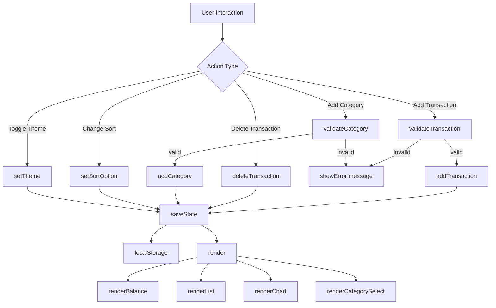

# Design Document

## Overview

The Expense & Budget Visualizer is a zero-dependency single-page application delivered as three static files (`index.html`, `css/style.css`, `js/app.js`). It runs entirely in the browser — no build step, no backend, no npm. All state is kept in two in-memory JavaScript arrays and mirrored to `localStorage` after every mutation. A single `render()` function drives all DOM updates, keeping the UI in sync with state.

The design follows a **unidirectional data-flow** pattern:

```
User Action → State Mutation → localStorage Sync → render() → DOM
```

This keeps the code predictable: every visible change originates from a state mutation, and every state mutation triggers `render()`.

---

## Architecture

### File Layout

```
index.html          ← markup skeleton, CDN script tag for Chart.js
css/style.css       ← CSS custom properties, layout, component styles, dark-mode overrides
js/app.js           ← all application logic (state, event handlers, render, utilities)
```

### Module Boundaries (within `app.js`)

`app.js` is organized into five conceptual sections — no ES modules, no bundler, just clearly separated regions with comments:

```
// ── 1. STATE ──────────────────────────────────────────────────────
// ── 2. PERSISTENCE (localStorage read / write) ────────────────────
// ── 3. UTILITIES (pure functions: format, sort, validate, colors) ──
// ── 4. RENDER (DOM reconciliation) ────────────────────────────────
// ── 5. EVENT HANDLERS & INIT ──────────────────────────────────────
```

### Data Flow Diagram



---

## Components and Interfaces

### HTML Structure

```
<body data-theme="light">
  <header>
    <h1>Expense & Budget Visualizer</h1>
    <button id="theme-toggle">🌙 Dark Mode</button>
  </header>
  <main>
    <!-- Total Balance Card -->
    <section id="balance-card" aria-label="Total balance">
      <p class="card-label">TOTAL BALANCE</p>
      <p id="balance-display">$0.00</p>
    </section>

    <!-- Add Transaction Card -->
    <section id="form-card">
      <form id="transaction-form">
        <label for="item-name">Item Name</label>
        <input id="item-name" type="text" autocomplete="off" />

        <label for="amount">Amount</label>
        <input id="amount" type="number" step="0.01" min="0.01" />

        <label for="category-select">Category</label>
        <select id="category-select"></select>

        <div id="form-error" role="alert" class="error hidden"></div>
        <button type="submit">Add Transaction</button>
      </form>

      <!-- Custom Category Sub-form -->
      <div id="add-category-row">
        <input id="new-category" type="text" placeholder="New category name" maxlength="20" />
        <button id="add-category-btn">+ Add Category</button>
        <div id="category-error" role="alert" class="error hidden"></div>
      </div>
    </section>

    <!-- Two-column row -->
    <div class="row">
      <!-- Transactions Card -->
      <section id="transactions-card">
        <h2>Transactions</h2>
        <label for="sort-select">Sort by</label>
        <select id="sort-select">
          <option value="newest">Newest first</option>
          <option value="amount-desc">Amount: High to Low</option>
          <option value="amount-asc">Amount: Low to High</option>
          <option value="category-az">Category: A to Z</option>
        </select>
        <ul id="transaction-list" class="transaction-list"></ul>
      </section>

      <!-- Chart Card -->
      <section id="chart-card">
        <h2>Spending by Category</h2>
        <canvas id="spending-chart"></canvas>
        <p id="chart-empty" class="hidden">Add a transaction to see the chart</p>
      </section>
    </div>
  </main>
</body>
```

### JavaScript Public Interface (functions accessible across the file)

| Function | Signature | Description |
|---|---|---|
| `loadState()` | `() → void` | Reads all four localStorage keys; populates `transactions`, `categories`, `currentTheme`, `currentSort`. |
| `saveState()` | `() → void` | Serializes and writes all four keys to localStorage. |
| `render()` | `() → void` | Calls `renderBalance`, `renderList`, `renderChart`, `renderCategorySelect`. |
| `renderBalance()` | `() → void` | Computes balance and updates `#balance-display`. |
| `renderList()` | `() → void` | Sorts a copy of `transactions`, clears `#transaction-list`, appends one `<li>` per transaction. |
| `renderChart()` | `() → void` | Destroys existing Chart instance if any, creates new pie chart, or shows empty state. |
| `renderCategorySelect()` | `() → void` | Repopulates `#category-select` from the `categories` array. |
| `computeBalance(arr)` | `(Transaction[]) → number` | Returns `arr.reduce((s, t) => s + t.amount, 0)`. |
| `formatCurrency(n)` | `(number) → string` | Returns dollar string: `"$1,234.56"`. |
| `sortTransactions(arr, option)` | `(Transaction[], string) → Transaction[]` | Returns a **copy** sorted by the given option. |
| `computeCategoryTotals(arr)` | `(Transaction[]) → Record<string, number>` | Returns `{ [category]: totalAmount }`. |
| `getCategoryColor(name, categories)` | `(string, string[]) → string` | Returns fixed color for built-in categories; palette color by index for custom ones. |
| `validateTransaction(name, amount, category)` | `(string, string, string) → { valid: boolean, error: string }` | Returns validation result with descriptive error message. |
| `validateCategory(name, existing)` | `(string, string[]) → { valid: boolean, error: string }` | Returns validation result for a new category name. |
| `addTransaction(name, amount, category)` | `(string, number, string) → void` | Builds transaction object, pushes to `transactions`, calls `saveState`, `render`. |
| `deleteTransaction(id)` | `(string) → void` | Filters `transactions` by id, calls `saveState`, `render`. |
| `addCategory(name)` | `(string) → void` | Pushes to `categories`, calls `saveState`, `render`. |
| `setSortOption(value)` | `(string) → void` | Updates `currentSort`, calls `saveState`, `render`. |
| `setTheme(value)` | `(string) → void` | Sets `currentTheme`, updates `data-theme` attribute, calls `saveState`, `render`. |

---

## Data Models

### Transaction

```javascript
{
  id:        string,   // Date.now().toString() — unique within a session
  name:      string,   // user-entered item name, trimmed
  amount:    number,   // positive float, e.g. 14.94
  category:  string,   // must be a value present in the categories array
  createdAt: string    // ISO 8601 date string: new Date().toISOString()
}
```

### Application State (module-level variables in `app.js`)

```javascript
let transactions = [];    // Transaction[]
let categories   = [];    // string[]
let currentTheme = "light";  // "light" | "dark"
let currentSort  = "newest"; // "newest" | "amount-desc" | "amount-asc" | "category-az"
let chartInstance = null;    // Chart | null — holds the active Chart.js instance
```

### localStorage Schema

| Key | Type | Default |
|---|---|---|
| `"ebv_transactions"` | `JSON.stringify(Transaction[])` | `"[]"` |
| `"ebv_categories"` | `JSON.stringify(string[])` | `'["Food","Transport","Fun"]'` |
| `"ebv_theme"` | `"light"` \| `"dark"` | system `prefers-color-scheme` |
| `"ebv_sort"` | `"newest"` \| `"amount-desc"` \| `"amount-asc"` \| `"category-az"` | `"newest"` |

### Category Color Mapping

```javascript
const FIXED_COLORS = {
  Food:      "#2ecc71",
  Transport: "#3498db",
  Fun:       "#e67e22"
};

const CUSTOM_PALETTE = [
  "#9b59b6", "#e74c3c", "#f1c40f", "#1abc9c", "#34495e"
];

function getCategoryColor(name, categories) {
  if (FIXED_COLORS[name]) return FIXED_COLORS[name];
  const customIndex = categories
    .filter(c => !FIXED_COLORS[c])
    .indexOf(name);
  return CUSTOM_PALETTE[customIndex % CUSTOM_PALETTE.length];
}
```

### CSS Custom Properties

```css
:root {
  --bg-page:    #f9f9f9;
  --bg-card:    #ffffff;
  --text-main:  #333333;
  --text-muted: #888888;
  --accent:     #3498db;
  --shadow:     0 2px 8px rgba(0,0,0,0.08);
  --radius:     8px;
  --transition: 0.2s ease;
}

[data-theme="dark"] {
  --bg-page:    #1a1a2e;
  --bg-card:    #16213e;
  --text-main:  #e0e0e0;
  --text-muted: #a0a0a0;
  --accent:     #5dade2;
  --shadow:     0 2px 8px rgba(0,0,0,0.4);
}
```

---

## Correctness Properties

*A property is a characteristic or behavior that should hold true across all valid executions of a system — essentially, a formal statement about what the system should do. Properties serve as the bridge between human-readable specifications and machine-verifiable correctness guarantees.*

### Property 1: Transaction object has all required fields with correct types

*For any* valid (name, amount, category) input, the transaction object produced by `addTransaction` must have an `id` of type string, a `name` of type string equal to the trimmed input, an `amount` of type number equal to the numeric input, a `category` of type string, and a `createdAt` field that is a valid ISO 8601 date string.

**Validates: Requirements 1.2**

---

### Property 2: State serialization round-trip preserves all state

*For any* application state (transactions array, categories array, theme string, sort string), writing the state to localStorage via `saveState()` and then reading it back via `loadState()` must produce a state that is structurally equal to the original.

**Validates: Requirements 1.4**

---

### Property 3: State hydration never throws and always produces valid defaults

*For any* combination of localStorage values — including valid JSON, malformed JSON, missing keys, or keys with unexpected types — calling `loadState()` must not throw an exception and must return arrays for `transactions` and `categories`, a string for `currentTheme`, and a string for `currentSort`.

**Validates: Requirements 1.5**

---

### Property 4: Form validation predicate is correct for all inputs

*For any* (name, amount, category) triple, `validateTransaction(name, amount, category)` returns `valid: true` if and only if `name.trim().length > 0`, `amount > 0`, and `category` is a non-empty string; otherwise it returns `valid: false` with a non-empty error message.

**Validates: Requirements 2.4**

---

### Property 5: Invalid form submit leaves transactions array unchanged

*For any* invalid input triple (failing at least one validation condition), calling the form submit handler must leave the `transactions` array with the same length and same contents as before the submission attempt.

**Validates: Requirements 2.5**

---

### Property 6: Valid form submit adds transaction with matching data

*For any* valid (name, amount, category) triple, after calling `addTransaction(name, amount, category)`, the `transactions` array must contain exactly one additional element whose `name` equals `name.trim()`, `amount` equals the numeric value, and `category` equals `category`.

**Validates: Requirements 2.6**

---

### Property 7: Rendered row count equals transaction count

*For any* non-empty `transactions` array, `renderList()` must produce a `#transaction-list` element containing exactly as many `<li>` children as there are transactions in the sorted display array.

**Validates: Requirements 3.2**

---

### Property 8: Delete removes exactly the targeted transaction

*For any* `transactions` array of length N and any transaction id `id` present in the array, calling `deleteTransaction(id)` must result in a `transactions` array of length N-1 that contains no element with `id` equal to `id`, and all other transactions are preserved unchanged.

**Validates: Requirements 3.6**

---

### Property 9: Balance equals the sum of all transaction amounts

*For any* `transactions` array, `computeBalance(transactions)` must equal `transactions.reduce((sum, t) => sum + t.amount, 0)`. An empty array must return `0`.

**Validates: Requirements 4.2**

---

### Property 10: Currency format produces a valid dollar string

*For any* non-negative number `n`, `formatCurrency(n)` must return a string that starts with `"$"`, contains exactly one decimal point, has exactly two digits after the decimal point, and uses commas as thousand separators for values ≥ 1000.

**Validates: Requirements 4.3**

---

### Property 11: Category totals aggregation is correct

*For any* `transactions` array, `computeCategoryTotals(transactions)` must return an object where each key is a category name present in the array, and each value equals the sum of `amount` for all transactions with that category. Categories with no transactions must not appear as keys.

**Validates: Requirements 5.2**

---

### Property 12: Category color assignment is deterministic

*For any* category name, `getCategoryColor(name, categories)` must always return the same color given the same `name` and `categories` array. Fixed categories (`Food`, `Transport`, `Fun`) must return their specified hex colors regardless of their position in the array.

**Validates: Requirements 5.3**

---

### Property 13: Category validation predicate is correct for all inputs

*For any* (name, existingCategories) pair, `validateCategory(name, existingCategories)` returns `valid: true` if and only if `name.trim().length > 0`, `name.trim().length <= 20`, and no element of `existingCategories` matches `name` using case-insensitive comparison.

**Validates: Requirements 6.2**

---

### Property 14: Deleting a transaction preserves the categories array

*For any* (transactions, categories) application state, after calling `deleteTransaction(id)` for any id in `transactions`, the `categories` array must be strictly equal in content and order to what it was before the deletion.

**Validates: Requirements 6.5**

---

### Property 15: Sort returns a correctly ordered copy without mutating the input

*For any* `transactions` array and any valid `sortOption`, `sortTransactions(transactions, sortOption)` must return a new array (not the same reference) that contains exactly the same transactions but ordered according to the option: `"newest"` → descending by `id` string (which encodes epoch time); `"amount-desc"` → descending by `amount`; `"amount-asc"` → ascending by `amount`; `"category-az"` → ascending by `category` alphabetically. The original input array must remain unchanged after the call.

**Validates: Requirements 3.5, 7.2**

---

## Error Handling

### Form Validation Errors

Both the transaction form and the add-category input use the same error display pattern:

1. The error container (`#form-error` or `#category-error`) starts with class `hidden`.
2. On a failed submission, the container has `hidden` removed, its `textContent` is set to the descriptive message, and it carries `role="alert"` so screen readers announce it immediately.
3. On a successful submission or when the user starts typing again, the container is re-hidden and its text is cleared.

Error messages by condition:

| Condition | Message |
|---|---|
| Item name empty or whitespace-only | "Please enter an item name." |
| Amount ≤ 0 or not a number | "Please enter a positive amount." |
| Category not selected | "Please select a category." |
| New category empty | "Please enter a category name." |
| New category > 20 characters | "Category name must be 20 characters or fewer." |
| New category duplicate (case-insensitive) | "That category already exists." |

### localStorage Errors

`loadState()` wraps all four `localStorage.getItem` and `JSON.parse` calls in a single `try/catch`. If any call throws (e.g. `localStorage` is disabled, or the stored value is corrupted JSON), the catch block silently assigns the default values:

```javascript
function loadState() {
  try {
    transactions  = JSON.parse(localStorage.getItem("ebv_transactions"))  || [];
    categories    = JSON.parse(localStorage.getItem("ebv_categories"))    || ["Food", "Transport", "Fun"];
    currentTheme  = localStorage.getItem("ebv_theme") || getSystemTheme();
    currentSort   = localStorage.getItem("ebv_sort")  || "newest";
  } catch {
    transactions  = [];
    categories    = ["Food", "Transport", "Fun"];
    currentTheme  = getSystemTheme();
    currentSort   = "newest";
  }
}
```

### Chart Lifecycle Errors

Before calling `new Chart(...)`, the code checks `chartInstance !== null` and calls `chartInstance.destroy()` to prevent the "Canvas is already in use" error from Chart.js. If `transactions` is empty, the canvas element is hidden with class `hidden` and the placeholder `<p>` is shown instead, avoiding an empty/broken chart render.

---

## Testing Strategy

### Dual Testing Approach

Unit tests cover specific examples and edge cases; property-based tests cover universal invariants across all inputs. Both are necessary: unit tests pin concrete behavior, property tests catch edge cases the author did not anticipate.

### Property-Based Testing

**Library:** [fast-check](https://github.com/dubzzz/fast-check) (JavaScript, runs in Node.js with any test runner).

**Configuration:** Each property test runs a minimum of **100 iterations**. Tag each test with a comment referencing the design property:

```javascript
// Feature: expense-budget-visualizer, Property 9: Balance equals sum of amounts
fc.assert(fc.property(
  fc.array(transactionArbitrary),
  (arr) => computeBalance(arr) === arr.reduce((s, t) => s + t.amount, 0)
), { numRuns: 100 });
```

**Arbitraries (input generators) needed:**

| Arbitrary | Description |
|---|---|
| `transactionArbitrary` | `{ id: string, name: nonEmptyString, amount: positiveFloat, category: categoryString, createdAt: isoDateString }` |
| `validNameArbitrary` | `fc.string().filter(s => s.trim().length > 0)` |
| `invalidNameArbitrary` | `fc.stringOf(fc.constant(' '))` (whitespace-only strings) |
| `positiveAmountArbitrary` | `fc.float({ min: 0.01, max: 1_000_000 })` |
| `nonPositiveAmountArbitrary` | `fc.oneof(fc.constant(0), fc.float({ max: 0 }))` |
| `categoryNameArbitrary` | `fc.string({ minLength: 1, maxLength: 20 })` |
| `sortOptionArbitrary` | `fc.oneof(fc.constant("newest"), fc.constant("amount-desc"), fc.constant("amount-asc"), fc.constant("category-az"))` |

**Properties mapped to tests:**

| Property | Test description |
|---|---|
| P1 | For any valid input, created transaction has all required fields |
| P2 | For any state, saveState → loadState is identity |
| P3 | For any localStorage contents, loadState never throws |
| P4 | For any input triple, validateTransaction returns correct boolean |
| P5 | For any invalid input, transactions array unchanged after submit |
| P6 | For any valid input, transactions array gains one matching element |
| P7 | For any non-empty transactions, rendered li count equals array length |
| P8 | For any id in array, deleteTransaction reduces length by 1 and removes that id |
| P9 | For any transactions array, computeBalance equals reduce sum |
| P10 | For any non-negative number, formatCurrency returns valid dollar string |
| P11 | For any transactions, computeCategoryTotals groups and sums correctly |
| P12 | For any category name, getCategoryColor returns same color consistently |
| P13 | For any (name, existing) pair, validateCategory returns correct boolean |
| P14 | For any state, deleteTransaction leaves categories unchanged |
| P15 | For any (array, sortOption), sortTransactions returns copy sorted correctly |

### Unit Tests

Unit tests (using plain `assert` or any lightweight test runner) cover:

- Default categories initialized to `["Food", "Transport", "Fun"]` when localStorage is empty
- `formatCurrency(0)` → `"$0.00"`
- `formatCurrency(1234.5)` → `"$1,234.50"`
- `formatCurrency(1000000)` → `"$1,000,000.00"`
- `computeBalance([])` → `0`
- Empty transaction list renders "No transactions yet"
- Empty transactions hides canvas and shows chart placeholder
- Theme toggle sets `data-theme` attribute correctly on `<body>`
- First load with no saved theme applies `prefers-color-scheme`
- Form fields are cleared and focus returns to `#item-name` after valid submission
- Each fixed category color is correct (Food → `#2ecc71`, etc.)

### Integration Tests

Integration tests run against the actual HTML page (using a headless browser or manual QA):

- Chart.js loads from CDN and canvas element is present on load
- Adding a transaction updates balance, list, and chart simultaneously
- Deleting a transaction updates balance, list, and chart simultaneously
- Dark mode applies correct colors to chart legend
- Responsive breakpoint at 768px stacks cards vertically
- All form inputs have associated `<label>` elements
- Error messages have `role="alert"`
